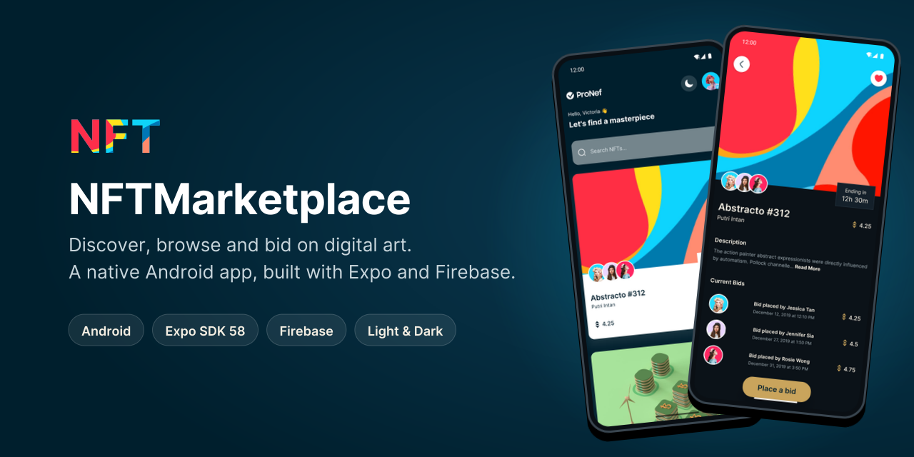
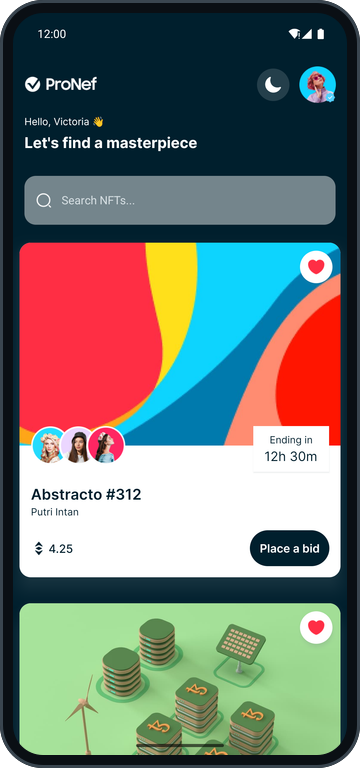
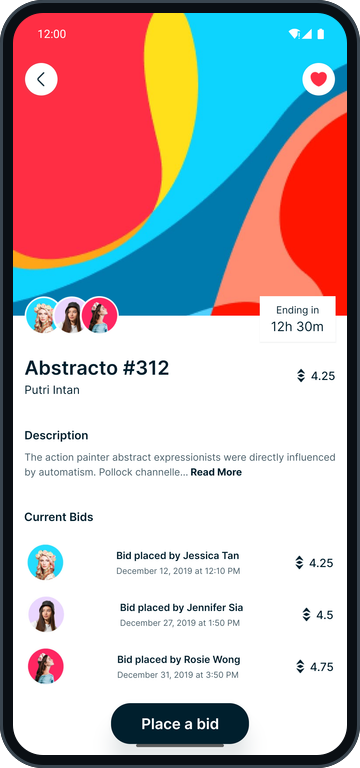
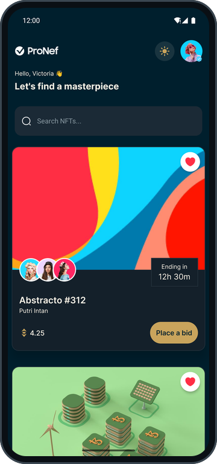
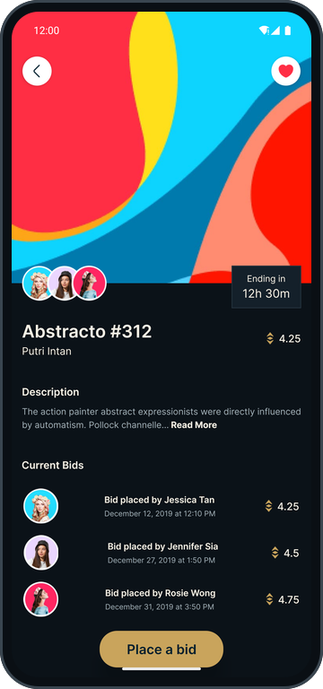

<p align="center">
  
</p>

<p align="center">
  <a href="https://github.com/maiznadeem/NFTMarketplace/releases/latest"></a>
  
  
  
  
</p>

<p align="center">
  <b>A sleek NFT marketplace for Android.</b> Browse curated digital art, explore each piece and its bids,<br/>
  and switch between handcrafted light and dark themes.
</p>

<p align="center">
  <a href="https://github.com/maiznadeem/NFTMarketplace/releases/latest"><b>⬇ Download the latest APK</b></a>
</p>

---

## Screenshots

<table align="center">
  <tr>
    <td align="center"></td>
    <td align="center"></td>
    <td align="center"></td>
    <td align="center"></td>
  </tr>
  <tr>
    <td align="center"><sub>Home · Light</sub></td>
    <td align="center"><sub>Details · Light</sub></td>
    <td align="center"><sub>Home · Dark</sub></td>
    <td align="center"><sub>Details · Dark</sub></td>
  </tr>
</table>

## Features

- **Live collection:** NFTs stream from Firebase Realtime Database and update instantly.
- **Instant search:** filter the collection by name as you type.
- **Rich details:** artwork, creator, price, description and the full bid history for every piece.
- **Light and dark themes:** follows your system by default. A one-tap toggle overrides it and is remembered.
- **Locked-down backend:** only the genuine app on a genuine device can read the data (see [Security](#security)).
- **Polished native feel:** edge-to-edge layout, adaptive and themed app icon, and a branded splash screen.

## Install

1. Open the [latest release](https://github.com/maiznadeem/NFTMarketplace/releases/latest) on your Android phone and download `NFTMarketplace-v<version>.apk`.
2. Open it and allow your browser to install unknown apps when Android asks.
3. Updates install over the previous version. Every release is signed with the same key (certificate SHA-1 `3F:57:AF:B7:2F:0E:56:2C:CE:DB:F6:25:4D:FA:F7:EA:BB:82:77:D6`). Each APK ships with a `.sha256` checksum.

## Security

The backend is built to serve this app and nothing else.

| Layer | What it does |
|---|---|
| **App Check (Play Integrity)** | Enforced on the database. Every request must carry an attestation that it comes from this app (package and release signing key) on a genuine, uncompromised device. Anything else gets `401`. |
| **Database rules** | [`database.rules.json`](database.rules.json) only allows reading `NFTData`. All writes are denied. |
| **Restricted API key** | The Android key only works for `com.himaiz.nftmarketplace` signed with the release certificate, and only for the Firebase APIs the app uses. |
| **No public assets** | Artwork is stored in the database itself, so it's covered by the same checks, instead of on a public bucket or host. |

> Rooted devices, custom ROMs and emulators can't pass device integrity, so they show *"Couldn't load NFTs on this device."*

## Tech stack

| | |
|---|---|
| **App** | React Native 0.88, Expo SDK 58 (Continuous Native Generation), React 19 |
| **Navigation** | React Navigation 7 (stack) |
| **Backend** | React Native Firebase: Realtime Database and App Check (Play Integrity) |
| **Theming** | Context-based light and dark palettes, persisted with AsyncStorage |
| **Typography** | Inter |
| **Builds** | Local Gradle release builds, signed through an Expo config plugin |

## Project structure

```
App.js                 App shell: fonts, theme, App Check, navigation
screens/               Home (list and search) and Details (artwork and bids)
components/            Cards, header, buttons, theme toggle
context/ThemeContext   Light/dark palettes and the saved preference
firebase/appCheck.js   App Check setup (Play Integrity; debug token for emulators)
plugins/               Expo config plugins: release signing, CMake pin, no force-dark
scripts/               build-android.ps1: signed release APK and checksum
data/images/           Source artwork stored in the database
```

## Development

```bash
npm install
npx expo run:android   # native modules mean a development build, not Expo Go
```

The database enforces App Check, so a development build or emulator needs a **debug token**:

1. Register a token for the Android app in Firebase Console → App Check.
2. Build with `EXPO_PUBLIC_APPCHECK_DEBUG_TOKEN=<token>`.
3. Delete the token when you're done. Never publish a build made with one; the release script refuses to unless `-AllowAppCheckDebugToken` is passed.

## Releasing

Versioning has a single source of truth: `version` in `package.json`. The Android `versionCode` is derived as `major × 10000 + minor × 100 + patch` (2.1.0 → 20100).

```bash
npm run version:minor          # or version:patch / version:major
npm run build:android          # prebuild, assembleRelease, sign, then dist/NFTMarketplace-v<version>.apk and .sha256
git tag v<version> && git push origin v<version>
gh release create v<version> dist/NFTMarketplace-v<version>.apk dist/NFTMarketplace-v<version>.apk.sha256 \
  --title "NFTMarketplace v<version>"
```

The build needs the Android SDK, a JDK (17 to 25) and the release keystore; its password comes from the local secret store. `android/` is generated and never committed.

---

<p align="center">Designed and built by <b>M. Maiz Nadeem</b></p>
